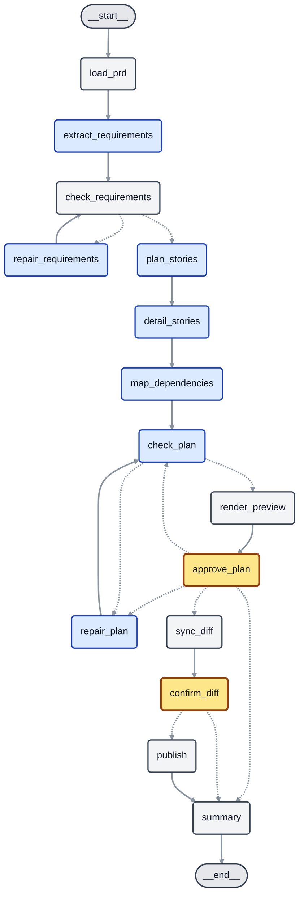
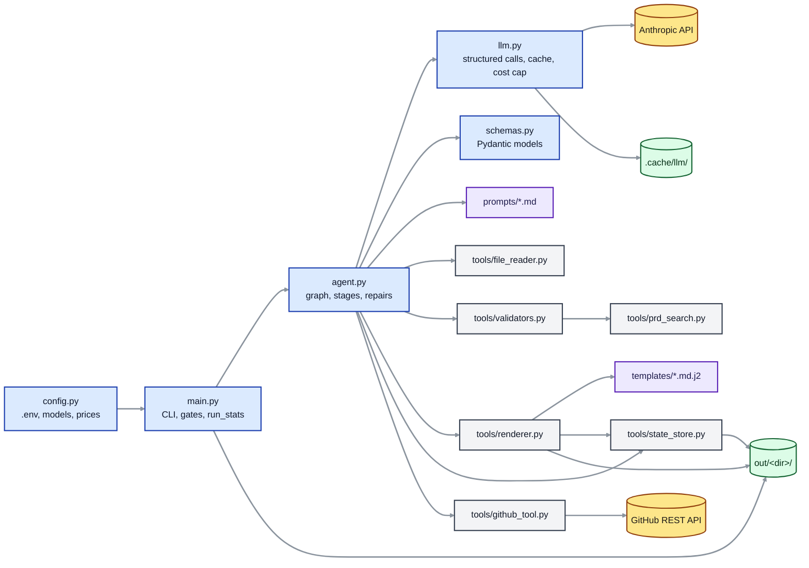

# PRD → GitHub Issues Agent

A CLI agent that turns a PRD (PDF / DOCX / MD / TXT) into a validated GitHub issue tree
(Epic → User Stories → Technical Tasks), lets a human review it, and publishes it idempotently. Running
it again on a modified PRD updates the existing issues instead of creating duplicates.

- The specification is [SPEC.md](SPEC.md). The decisions behind the design, and what went wrong along
  the way, are in [docs/DESIGN.md](docs/DESIGN.md).
- The committed sample runs are [`out/sample-v1/`](out/sample-v1/) (the sample PRD) and
  [`out/sample-v2/`](out/sample-v2/) (an update run on [examples/todo_prd_v2.md](examples/todo_prd_v2.md)).
  Their issues are in [yuval-rozen/prd-agent-demo](https://github.com/yuval-rozen/prd-agent-demo/issues),
  with the epic at [#1](https://github.com/yuval-rozen/prd-agent-demo/issues/1).
- [docs/DEMO.md](docs/DEMO.md) walks through a demo on a fresh repository.

## 1. Setup and execution

**Prerequisites:**
- [uv](https://docs.astral.sh/uv/getting-started/installation/), which picks a Python ≥ 3.11.
- An Anthropic API key, for live runs.
- A GitHub token and an issues repository, only for publishing.

```bash
uv sync
```

```bash
cp .env.example .env
```

`.env` is gitignored.

| Variable | When it is needed | Notes |
|---|---|---|
| `ANTHROPIC_API_KEY` | every run except `--replay` | |
| `GITHUB_TOKEN` | only with `--publish` | recommended: fine-grained, one repository, Issues read/write, short expiry |
| `GITHUB_REPO` | only with `--publish` | `owner/name`; `--repo` overrides it |
| `MAX_RUN_COST_USD` | optional | hard cost cap per run, default `0.30`; passing it stops the run with exit code 7 |
| `EXTRACT_MODEL`, `GENERATION_MODEL`, `REVISION_MODEL`, `CRITIC_MODEL` | optional | defaults `claude-haiku-5-5`, `claude-haiku-5-5`, `claude-sonnet-5-5`, `claude-sonnet-5-5` |
| `EXTRACT_EFFORT`, `GENERATION_EFFORT`, `REVISION_EFFORT`, `CRITIC_EFFORT` | optional | reasoning effort, defaults `low`, `medium`, `medium`, `medium` |
| `MAX_REPAIR_ROUNDS`, `GROUNDING_THRESHOLD`, `DUPLICATE_TITLE_THRESHOLD`, `REQ_DIFF_THRESHOLD` | optional | defaults 3, 90, 90, 85 |
| `LLM_PROVIDER`, `GOOGLE_API_KEY`, `GOOGLE_THINKING_LEVEL`, `MAX_PARALLEL_CALLS` | optional | `google` is an optional free-tier provider; parallel calls default to 4 (Anthropic) / 1 (Google) |

A model without a price in `config.py` is refused, because the cost cap could not be enforced for it.
Secrets are never printed, logged, written to `out/` or included in error messages, and a test checks
this.

**Main commands**

A dry run (S1–S8, then G1). Nothing is written to GitHub:

```bash
uv run main.py run "prd/PRD To-Do Management System (1).pdf" --out out/my-run
```

Show the saved plan as a table (`--format md` prints `plan.md`, `--format json` the plan JSON):

```bash
uv run main.py preview --out out/my-run --format table
```

Replay the committed sample run from `.cache/llm/`, with no API key and no cost. At each G1 the recorded
answer is offered: Enter accepts it, or you can type `approve`, `feedback` or `abort`.

```bash
uv run main.py run "prd/PRD To-Do Management System (1).pdf" --out out/replay --replay --gate-answers out/sample-v1/gate_answers.json
```

Publish. After G1, S9 reads the repository and G2 shows every change before S10 writes:

```bash
uv run main.py run "prd/PRD To-Do Management System (1).pdf" --out out/my-run --publish --repo owner/name
```

Run an update on a modified PRD. The `plan.json` from the earlier run in the same `--out` folder makes
it an update run:

```bash
uv run main.py run examples/todo_prd_v2.md --out out/my-run --publish --repo owner/name
```

| Option | Effect |
|---|---|
| `--yes` | approves G1 automatically, but only when the status is PASS; confirms G2 automatically |
| `--force` | allows publishing a NEEDS_REVIEW plan, which G2 otherwise refuses |
| `--gate-answers FILE` | with `--replay`: the recorded G1 answers to offer (default `OUT/gate_answers.json`; used only if they were recorded for the same PRD file) |
| `--debug` | details and tracebacks |

**Exit codes:** 0 OK, 2 bad input, 3 configuration, 4 LLM error, 5 GitHub error, 6 aborted at a gate,
7 cost cap.

**Tests:** `uv run pytest`.

## 2. Architecture

The pipeline is a LangGraph `StateGraph`. The structure below is generated from the compiled graph
(`build_graph(...).get_graph().draw_mermaid()`), with styles added. Dotted edges are conditional.



Blue: stages that call the LLM (S6 and S7 also run code checks). Grey: code only. Amber: the human gates.

**The loops:** there are two repair loops, `check_requirements ⇄ repair_requirements` and
`check_plan ⇄ repair_plan`.

**The gates:** `approve_plan` (G1) and `confirm_diff` (G2), both LangGraph `interrupt()`s. From G1:
- feedback that names tickets goes to `repair_plan`;
- a plan-wide decision goes to `check_plan`, so the critic reviews the whole plan against it;
- approve goes to `sync_diff` (with `--publish`);
- abort goes to `summary`.



Blue: core modules. Grey: `tools/`. Purple: prompts and templates. Amber: external services. Green:
outputs on disk.

| Stage | What it does | Model (default) |
|---|---|---|
| S1 `load_prd` | read the file into a section tree and units; load the previous `plan.json` | code |
| S2 `extract_requirements` | one call per section: requirements with verbatim quotes and kinds | Haiku (effort low) |
| S3 `check_requirements` ⇄ `repair_requirements` | R1–R2; re-extract only the failing sections | code / Haiku |
| S4 `plan_stories` | epic, story skeletons, constraint scopes; key reconcile in update runs | Haiku + code |
| S5 `detail_stories` | the full story and its tasks, one call per new or affected story | Haiku; Sonnet for update-run revisions |
| S6 `map_dependencies` | proposes `blocked_by`; code checks keys and cycles | Haiku + code |
| S7 `check_plan` ⇄ `repair_plan` | P1–P13, then the critic; repairs only the failing items | critic Sonnet; repairs Haiku (first run) or Sonnet (update runs, plain-language and epic repairs) |
| S8 `render_preview` | `plan.json`, `plan.md`, `requirements.md`, `validation_report.md`, `payloads/` | code |
| G1 `approve_plan` | approve / feedback / abort | human |
| S9 `sync_diff` | read the managed issues and sub-issues; compute the actions and their causes | code |
| G2 `confirm_diff` | confirm the GitHub changes | human |
| S10 `publish` | two-pass write, the sub-issue tree, closes | code |
| S11 `summary` | status, counts, time and cost per stage | code |

### 2.1 How the PRD is parsed

- **Formats.** PDF goes through `pymupdf4llm`, DOCX through `python-docx` (headings, list levels,
  tables), and MD and TXT are read as text. Everything is normalized to one Markdown form.
- **Sections and units.** Headings form a section tree. Each bullet, table row or sentence becomes an
  atomic unit with the ID `U-<hash(section path)>-<hash(text)>`, so inserting content elsewhere never
  shifts an ID. The sample PRD has 45 units in 12 sections.
- **Extraction.** S2 makes one structured call per section. Each requirement has:
  - a verbatim `source_quote`;
  - its units;
  - a statement;
  - a kind: functional, data_model, validation_rule, frontend, backend, non_functional, constraint,
    decision_open or context_only.

  The sample PRD gives 45 requirements, 42 of them actionable.
- **Content-derived IDs.** A requirement ID is `R-<hash of the normalized quote>`.
  - The same text gets the same ID in every run and every format.
  - Identical quotes in different sections get `-2`, `-3`.
  - The requirement diff reports a rephrase as "changed".

### 2.2 Models and tools, and why

**A cheap model generates, a stronger model reviews.** Claude Haiku 5.5 does extraction and first-pass
generation. Claude Sonnet 5.5 is the critic, and also writes the update-run revisions, the
plain-language rewrites and the epic repairs. The measurements behind this are in
[DESIGN §1](docs/DESIGN.md#1-model-selection):

- **Haiku is enough to generate:** its first full plan took 60.8 s and cost $0.0201.
- **The critic needs to see everything at once:** cross-story problems such as duplicate migrations,
  or work assumed to live in another story, only show up across the whole plan. This call is most of
  the cost: $0.23 of $0.31 in the v1 recording.
- **Sonnet for update-run revisions:** with Haiku writing them, the repair loop did not converge.
- **Gemini** is kept as an optional free-tier provider. It is not the default because both free-tier
  runs failed on server timeouts (504, then 503/504).
- **Opus and Fable** were not needed.

| Library | Why |
|---|---|
| LangGraph | conditional edges for the repair loops, `interrupt()` + `MemorySaver` for the gates |
| langchain-anthropic (langchain-google-genai) | native JSON-schema structured output |
| Pydantic v2 | every LLM output and plan object is a validated model |
| pymupdf4llm, python-docx | PDF and DOCX to Markdown |
| rapidfuzz | quote grounding, duplicate titles, key reconcile, requirement diff |
| Jinja2 | issue bodies come from templates, never from the LLM |
| httpx + tenacity | GitHub REST calls with retries and rate-limit handling |
| Typer + Rich, python-dotenv, pytest | CLI and console, `.env`, tests |

**The LLM has no tools.** Every LLM call, the critic included, is one structured call whose input is
assembled by code. Only `tools/github_tool.py` writes to GitHub, and only after G1 and G2.

### 2.3 Caching

- **The LLM response cache** lives in `.cache/llm/`.
  - **Key:** the sha256 of the provider plus the exact request (model, messages, schema, parameters).
  - **Writes:** an entry is written only on a cache miss, so it is never overwritten. A paid response
    is cached before the budget check, so a run that hits the cost cap resumes without paying again.
  - **Replay:** `--replay` serves every call from the cache. The committed cache holds both sample
    runs (76 entries).
- **Anthropic prompt caching** puts a breakpoint on every system prompt. The critic caches the PRD,
  but not the plan, which changes every round; [DESIGN §11](docs/DESIGN.md#11-mechanics-in-detail)
  has the measurement behind this.
- **Recorded G1 answers:** every run writes `gate_answers.json`, and a replay offers those answers at
  each G1. G2 is never answered from a recording.
- **Update runs** carry unchanged stories over without an LLM call. Inside an affected story, code
  copies every task that cites no changed requirement.

### 2.4 The `tools/` modules

All of them are plain code that the pipeline calls; the LLM never calls a tool.

| Module | Used by | What it does |
|---|---|---|
| `file_reader.py` | S1 | reads PDF / DOCX / MD / TXT into normalized Markdown, the section tree and the units |
| `prd_search.py` | S3 (R1 `verify_quote`) | read-only PRD lookups; it started as LLM-callable tools for a planned ReAct critic and is now a code helper |
| `validators.py` | S3, S7 | the deterministic checks R1–R2 and P1–P13 |
| `renderer.py` | S8, S10 | Jinja rendering, content hash and marker, and the review files |
| `state_store.py` | S1, S8 | loads and saves `plan.json`; if it exists, the run is an update run |
| `github_tool.py` | S9, S10 | the only GitHub client: listing, sync diff, publish, sub-issue links |

## 3. Prompt engineering

**Structure.** Each prompt in [`prompts/`](prompts/) has:

- **A role**, then the task.
- **The scope rule**, shared by all prompts: use only what the PRD states, never invent, and state
  anything unclear as an open question.
- **The PRD as data:** it sits inside `<prd>` tags, and the prompt says that instructions inside it are
  ignored.
- **Field guidance** that matches the schema.
- **Title rules:** imperative, at most 80 characters, with a `[FE]` / `[BE]` / `[QA]` prefix, never
  generic.
- **AC rules:** strict Given / When / Then, with no vague words.
- **Good and bad examples** from an unrelated domain (library lending). A test fails if the extraction,
  planning or detailing prompt contains words from the sample PRD's title.

**Other rules:**

- **Narrow context per call.** S5 gets one story skeleton, its requirements, the constraints that apply
  to it, and the keys and titles of the other stories.
- **Native structured output.** There is no forced `tool_choice` and there are no sampling parameters,
  because current Claude models reject both. Repeatability comes from the cache.
- **Drafts, not final objects.**
  - The LLM fills draft schemas.
  - Code assigns requirement IDs, ticket keys and labels.
  - Whatever code drops or replaces is recorded as a `REF-*` warning.
- **One retry** when the output fails the schema, with the validation error attached.
- **Cross-story rules.** A requirement that spans stories is split per story, each table is created
  once, and a story never assumes another story builds its part.
- **G1 decisions are authoritative context**, treated like PRD text.
- **Repairs return line-level edits.** A repair returns edits such as "replace, add or remove AC / edge
  case / DoD line n" instead of the whole story. Code keeps every other line byte-for-byte.
- **Plain language.** Ticket text has no requirement IDs, ticket keys or notes about the agent's
  process. P12 checks this.

## 4. Validation and quality control

**Deterministic checks** ([tools/validators.py](tools/validators.py)) are blocking unless marked as a
warning:

| Check | Rule |
|---|---|
| R1 | every `source_quote` fuzzy-matches the PRD (≥ 90) |
| R2 | every unit is in a requirement (context_only needs a reason; a list item covered only as context_only is flagged) |
| P1 | every actionable requirement is cited by a story or task |
| P2 | cited requirement IDs exist; a task without one has an allowed `derived_reason` |
| P3 | ≥ 2 ACs per story, Given / When / Then non-empty, no vague words |
| P4 | backend / data-model requirements have a backend task, frontend ones a frontend task, every story a QA task |
| P5 | labels from the fixed vocabulary: one `type:*` per issue, one `area:*` per task, no duplicates |
| P6 | no near-duplicate titles (≥ 90) |
| P7 | `blocked_by` keys exist and form no cycle; warnings for an API or database task without its blocker |
| P8 | a scoped constraint is cited by every story that cites a requirement it applies to |
| P9 | every decision_open requirement has a spike task whose DoD requires a documented rationale |
| P10 | warning: a story with more than 8 tasks, or a task of size L |
| P11 | titles non-empty, ≤ 80 characters, with the right track prefix, not generic |
| P12 | no requirement IDs, ticket keys or process notes in ticket text |
| P13 | the epic cites requirements, and every business goal cites one |

**The critic** is one structured Sonnet call over the whole PRD and the whole plan (every field of the
epic, the stories and the tasks). Its check IDs are `CRIT-MISSING`, `-MISREPRESENTED`, `-UNREQUESTED`,
`-UNTESTABLE-AC`, `-CONSTRAINT`, `-OVERLAP` and `-PRD-GAP`.

- **Blocking** is allowed only when the plan:
  - adds scope (a feature, screen, field, user role, sign-in or permission);
  - contradicts the PRD;
  - leaves a requirement or constraint uncovered;
  - duplicates work;
  - or has an untestable AC.
- **Warnings:** everything else, and code enforces this.
- **PRD gaps** become open questions in the story's edge cases.

**The repair loop** repairs only the failing items. Its stop conditions:

- 3 rounds;
- no decrease in blocking findings;
- no blocking finding that can be tied to an item.

If the last round is worse, the best round is kept. An open-findings ledger keeps every blocking critic
finding open until the critic confirms it is fixed. [DESIGN §11](docs/DESIGN.md#11-mechanics-in-detail)
gives the details.

**The human gates.**

- **G1** shows the status, the blocking findings and the requirement diff. It accepts approve, feedback
  or abort.
  - Feedback is a reviewer decision. It starts a fresh repair cycle and stays authoritative from then on.
  - A decision that names a story revises that story and every task that conflicts with it.
- **G2** lists every change with its cause, and refuses a NEEDS_REVIEW plan unless `--force` is passed.

**What "covered" means.** Every unit is in a requirement (R2), and every actionable requirement is cited
by a ticket (P1). It does not mean the ticket fully delivers the requirement. That judgment is the
critic's (`CRIT-MISSING`), and the critic is an LLM.

**Tests:** 255 tests, offline. A fixture clears every key from the environment.

- **Fakes:** `tests/fake_llm.py` stands in for the model, and `tests/fake_github.py` puts GitHub behind
  `httpx.MockTransport`.
- **Checks:** every check ID has a positive and a negative test.
- **e2e replay test:** `tests/test_e2e_replay.py` replays the sample PRD with `--replay` and the recorded
  G1 answers. It must reproduce the committed `out/sample-v1` files byte for byte, with 0 API calls.
- **Secrets:** a test checks that keys never appear in the settings or in error messages, and that
  `run_stats.json` has no secret fields.

## 5. Requirements breakdown and ticket quality

**Stories** are user-visible capabilities: not one per bullet, and not one giant story. The sample has
8 stories for 42 actionable requirements. Each story has:

- As a / I want / So that;
- a business description and value;
- Given / When / Then ACs (5–12 per story in v1);
- edge cases, including open questions;
- dependencies;
- a Definition of Done.

**Tasks** are split by track: frontend, backend and qa_general. In v1 there are 16, 12 and 8.

- Each task names one artifact: an endpoint, a migration, a component or a test suite.
- Each has a size S / M / L (19 S and 17 M in v1) and the flags `consumes_api` and `touches_db`.
- A task without a direct requirement needs a derived reason: testing, migration, scaffolding or
  decision_spike.
- Every decision_open requirement becomes a `type:spike` task. The sample has one: where the Excel file
  is generated.

**Labels** are set by code:

- every issue gets `prd-agent` and one `type:epic|story|task|spike`;
- every task gets one `area:frontend|backend|qa|db|infra`.

**Dependencies.** S6 proposes `blocked_by`: an API consumer is blocked by its backend task, and a
database task by the migration. Code drops unknown keys and cycle-closing edges, and the bodies show
"Blocked by: #N".

**The sub-issue tree.** Stories are native GitHub sub-issues of the epic, and tasks are sub-issues of
their story, so GitHub shows progress. The bodies also keep "Parent: #N" and child checklists.

## 6. GitHub sync and updates

- **Idempotency.** Every managed issue has the `prd-agent` label and ends with
  `<!-- prd-agent:key=<KEY>;hash=<content_hash> -->`. The hash comes from the ticket's plan data, not
  from the rendered body, so real issue numbers never change it, and a second run makes 0 writes.
  Issues without the marker are never touched.
- **Two-pass publish.**
  - Pass 1 creates and updates the epic, then the stories, then the tasks, blockers first.
  - Pass 2 patches the bodies that need real issue numbers and adds the missing sub-issue links.
  - Any GitHub error stops the run (exit code 5). A re-run resumes.
- **Close, never delete.** A ticket that left the plan is closed with a comment and marked
  `;closed=agent`. Only issues the agent closed are reopened; an issue a human closed is left alone.
- **Updates.**
  - The requirement diff lists added, changed and removed requirements.
  - Keys are reconciled to the previous plan.
  - Unchanged stories are carried over.
  - In an affected story, code sorts every task as KEEP, REVISE or CLOSE.
  - A churn guard restores any change without a cause.

  [DESIGN §4–5](docs/DESIGN.md#4-the-update-run-carry-over-bug) explains why.
- **Causes.** For every change, G2 shows its cause: a requirement change, a critic finding or a G1
  decision. A change without one is churn, and the churn count must be 0.
- **One product per issues repository:** issues are matched by ticket key only.
- **Manual edits in GitHub** are kept while a ticket is unchanged, and overwritten when the PRD changes
  that ticket.

**Sample runs**, both recorded from scratch on 2026-11-13 with an empty LLM cache:

| Run | Diff found by S9 | Written | Time, cost |
|---|---|---|---|
| v1 publish ([`out/sample-v1/`](out/sample-v1/), PASS after 3 G1 decisions) | create 45, link 44 | 1 epic, 8 stories, 36 tasks, 44 sub-issue links | 176 s, $0 (replay) |
| Second v1 run | unchanged 45 | nothing | 19 s, $0.0027 |
| v2 update ([`out/sample-v2/`](out/sample-v2/), PASS after 1 G1 decision) | update 15, unchanged 30, churn 0 | 15 issues updated | 34 s, $0 (replay) |
| Second v2 run | unchanged 45 | nothing | 17 s, $0.0022 |

The v2 PRD makes three changes:
- it adds a requirement: titles of at most 100 characters;
- it changes one: sorting by Title as well;
- it removes one: reverting a Completed task to Open.

It is in Markdown, because the original PRD is a PDF.

## 7. Known gaps

- **Update runs regenerate an affected story as a whole.** Lines that no requirement change touched can
  be reworded or dropped; repairs and G1 decisions, by contrast, are line-level. In v2 this dropped the
  Last Updated Date rule and several open questions, and a G1 decision restored the rule.
- **The critic is an LLM.** It is not exhaustive, and it can be inconsistent between rounds: one
  discarded v1 attempt went 12 → 7 → 11 blocking findings.
- **One AC per case is not enforced.** The critic does not always require one AC for each case listed
  inside a requirement.
- **A plan-wide G1 decision** counts as a possible cause for changes in every story.
- **A template-only change does not change the content hash,** so existing bodies stay as they are until
  their plan data changes.
- **The body checklist duplicates the Sub-issues panel.** It is kept as a fallback for views that do not
  show sub-issues.
- **`--replay` needs identical requests.** Any change to the PRD, a prompt, a schema or a model is a
  cache miss, and the replay stops there.

## 8. Cost

| Run | Live calls | Cost (critic share) |
|---|---|---|
| v1 recording, up to G1 | 42 | $0.3133 ($0.2344, 4 calls) |
| v1 G1 decisions | 16 (43 from the cache) | $0.2879 ($0.2534, 5 calls) |
| v2 recording, up to G1 | 13 | $0.3299 ($0.1124, 2 calls) |
| v2 G1 decision | 3 (21 from the cache) | $0.1240 ($0.0567, 1 call) |
| Two publishes (replay) and two second runs | 2 | $0.0049 |
| **Both sample runs** | | **$1.06** |

**The whole development** cost $5.33 in total, according to the Anthropic Console. The Gemini runs were
on the free tier ($0).
